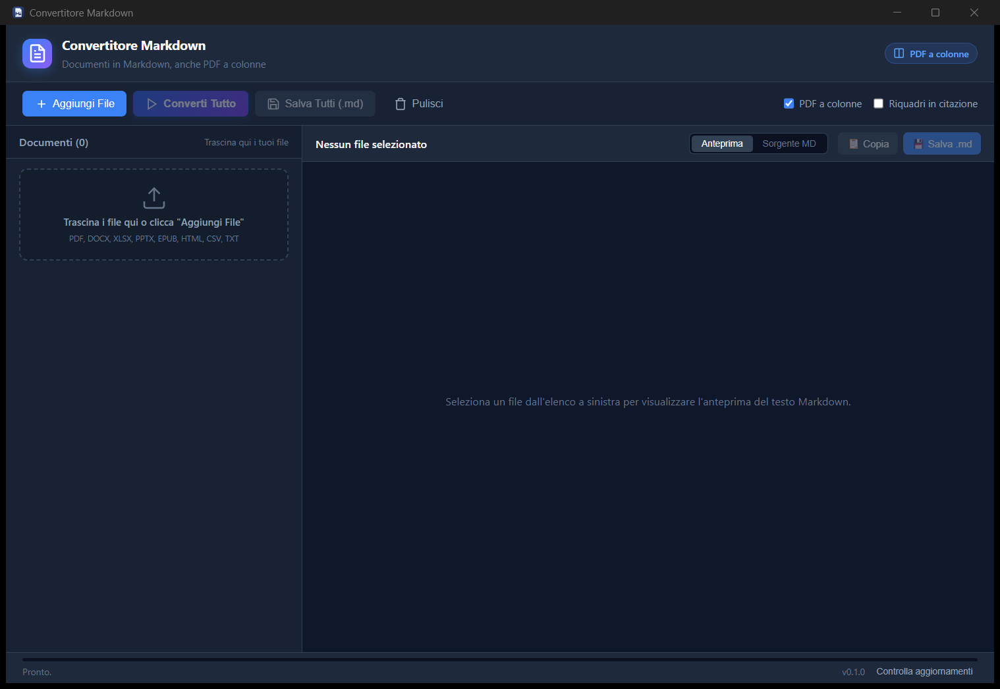

# Convertitore Markdown

Trascina un documento nella finestra e ottieni il suo testo in Markdown, pulito e pronto da modificare. Tutto resta sul tuo computer.

[](LICENSE)
[](https://github.com/dilfalmd/convertitore-markdown/releases)




## Cosa fa

- **Aggiungi uno o più file** con il selettore oppure trascinandoli nella finestra: puoi convertirne molti insieme.
- **PDF a una, due o tre colonne.** Il motore, basato su PyMuPDF, riconosce le colonne e le rimette nell'ordine di lettura, ricongiunge le parole spezzate dalla sillabazione e toglie testate, piè di pagina e numeri di pagina.
- **Indice cliccabile**, costruito a partire dal sommario (i segnalibri) del PDF.
- **Bibliografia in elenco:** le voci bibliografiche diventano un elenco ordinato.
- **Riquadri in citazione:** i testi nei riquadri delle pagine possono essere resi come citazioni Markdown (`>`). L'opzione è spenta di serie.
- **Altri formati** (Word, Excel, PowerPoint, EPUB, HTML, CSV, TXT) convertiti con Microsoft MarkItDown.
- **Anteprima renderizzata** e **sorgente Markdown modificabile**: controlli il risultato e lo correggi prima di salvarlo.
- **Salva .md**, **Salva tutti** (una volta sola per tutti i file) e **Copia** negli appunti.
- **Controlla aggiornamenti:** un pulsante, solo a richiesta, confronta la tua versione con l'ultima release su GitHub.

## Formati supportati

| Formato | Estensioni | Come viene convertito |
| --- | --- | --- |
| PDF (anche a più colonne) | `.pdf` | PyMuPDF, con riordino delle colonne |
| Word | `.docx` | Microsoft MarkItDown |
| Excel | `.xlsx` | Microsoft MarkItDown |
| PowerPoint | `.pptx` | Microsoft MarkItDown |
| EPUB | `.epub` | Microsoft MarkItDown |
| HTML | `.html`, `.htm` | Microsoft MarkItDown |
| CSV | `.csv` | Microsoft MarkItDown |
| Testo semplice | `.txt` | Microsoft MarkItDown |

I file audio non sono supportati. I PDF che contengono solo immagini di pagine (scansioni) non hanno testo da estrarre: servirebbe prima un riconoscimento del testo (OCR), che questa app non fa.

## Scarica

Le versioni pronte da installare sono nella pagina [Releases](https://github.com/dilfalmd/convertitore-markdown/releases): scegli il file per il tuo sistema.

| Sistema | File |
| --- | --- |
| Windows | installer `.msi` o `.exe` |
| macOS | `.dmg` (solo Mac con Apple Silicon) |
| Linux | `.deb`, `.rpm` o `.AppImage` |

Non serve installare Python né altro: il motore di conversione è già dentro l'app.

Le applicazioni non sono firmate con un certificato a pagamento, perciò il sistema può chiederti una conferma la prima volta:

- **Windows (SmartScreen):** se compare «Windows ha protetto il PC», scegli **Ulteriori informazioni** e poi **Esegui comunque**.
- **macOS (Gatekeeper):** se l'app non si apre perché «proviene da uno sviluppatore non identificato», fai clic destro sull'app, scegli **Apri** e conferma. In alternativa vai in **Impostazioni di Sistema → Privacy e sicurezza** e premi **Apri comunque**.
- **Linux:** per l'AppImage ricordati di renderla eseguibile (`chmod +x Convertitore*.AppImage`).

## Compilare dai sorgenti

### Requisiti

- [Rust](https://www.rust-lang.org/tools/install) (canale stabile)
- [Node.js](https://nodejs.org/) 20 o successivo
- [Python](https://www.python.org/) 3.12 o successivo
- Su Linux, le librerie di sistema di Tauri (vedi sotto)

### Windows

Da PowerShell, nella cartella del progetto:

```powershell
.\build.ps1
```

### macOS e Linux

```bash
./build.sh
```

### Passo per passo

Gli script fanno, in sostanza, questi tre passi:

```bash
# 1. Motore Python: crea src-tauri/binaries/convertitore-engine-<target-triple>[.exe]
pip install -r engine/requirements.txt -r engine/requirements-dev.txt
python engine/build_engine.py

# 2. Dipendenze Node
npm ci

# 3. App e installer
npx tauri build
```

Per provare l'app senza creare gli installer servono il motore compilato (passo 1, altrimenti Tauri non parte) e le dipendenze Node (`npm ci`): poi usa `npx tauri dev`.

### Dipendenze di sistema su Linux

Esempio per Debian e Ubuntu (vedi la [guida di Tauri](https://v2.tauri.app/start/prerequisites/#linux) per le altre distribuzioni):

```bash
sudo apt-get update
sudo apt-get install -y build-essential curl file wget patchelf libssl-dev \
  libxdo-dev libwebkit2gtk-4.1-dev libayatana-appindicator3-dev librsvg2-dev
```

### Release automatiche

Il file `.github/workflows/release.yml` compila gli installer per Windows, macOS e Linux e li carica in una release in bozza ogni volta che si pubblica un tag che comincia per `v` (per esempio `v1.0.0`).

## Come funziona

```
┌──────────────────────────────┐
│  Interfaccia (HTML/JS)       │   anteprima, sorgente, salvataggio
└──────────────┬───────────────┘
               │ Tauri (Rust)
┌──────────────▼───────────────┐
│  Motore Python (sidecar)     │   PyMuPDF per i PDF
│  compilato con PyInstaller   │   MarkItDown per gli altri formati
└──────────────────────────────┘
```

L'app è costruita con [Tauri](https://tauri.app/): una finestra leggera che mostra l'interfaccia web. La conversione la fa un programma Python separato (il «sidecar»), compilato con PyInstaller e incluso nell'installer, che l'app avvia quando serve. Per questo chi scarica l'app non deve installare Python.

## Privacy

Tutto avviene in locale: i documenti non lasciano mai il tuo computer, non c'è nessun account, nessuna telemetria e nessun servizio di intelligenza artificiale. L'unica connessione a internet è quella del pulsante **Controlla aggiornamenti**, che parte solo quando lo premi e legge soltanto l'elenco delle release pubbliche su GitHub.

## Licenza

Copyright © 2026 Diletta Falcone.

Questo programma è software libero, distribuito secondo i termini della **GNU Affero General Public License**, versione 3 o (a tua scelta) qualsiasi versione successiva (`AGPL-3.0-or-later`). Il testo completo è nel file [LICENSE](LICENSE). La scelta della licenza dipende da PyMuPDF, che è anch'esso distribuito con la AGPL.

## Ringraziamenti

- [MarkItDown](https://github.com/microsoft/markitdown) di Microsoft (licenza MIT), per la conversione di Word, Excel, PowerPoint, EPUB, HTML, CSV e TXT.
- [PyMuPDF](https://pymupdf.readthedocs.io/) di Artifex (licenza AGPL), per la lettura dei PDF.
- [marked](https://github.com/markedjs/marked) (licenza MIT), per l'anteprima del Markdown.
- [DOMPurify](https://github.com/cure53/DOMPurify) (Apache-2.0/MPL-2.0), per rendere sicura l'anteprima.
- [Tauri](https://tauri.app/), per la struttura dell'applicazione.

Progetto indipendente, non affiliato a Microsoft né ad Artifex.
